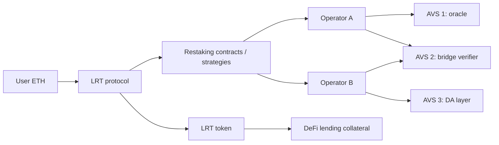

# Shared Security Basics

**Restaking** lets staked assets (natively staked ETH or liquid staking tokens) secure additional services beyond the base chain. EigenLayer popularised the model; others (Symbiotic, Karak and more) followed. Services secured this way are called **AVSs** (Actively Validated Services) in EigenLayer's terminology: oracles, bridges, data availability layers, coprocessors and more.

Restaking protocols change their designs often: slashing went from "planned" to live, allocation models changed, and new protocols launched with different terms. This book describes mechanisms. Before relying on any parameter, read the current documentation and contracts of the protocol in question.

## The promise

New protocols "rent" economic security instead of bootstrapping their own token and validator set. A new oracle network that would need years to build a valuable token can instead ask operators backed by existing stake to run its software, and threaten that stake with slashing if they misbehave.

## The risk

The same stake now backs multiple obligations. If slashing conditions in several services trigger at once, or one service is attacked in a way that makes slashing profitable, losses can **cascade**: to operators, to restakers, to liquid restaking tokens (LRTs), and to DeFi protocols using LRTs as collateral.

There is also a quieter risk: **security that is not really there**. If slashing cannot actually be executed (because stake can leave first, or a committee will veto it, or the condition cannot be proven on-chain), the AVS is advertising borrowed security it does not have.

## Actors

| Actor | Role | Risk taken |
|---|---|---|
| Restaker | deposits stake, delegates to operators | slashing, smart contract risk, LRT depeg |
| Operator | runs AVS software | slashing for faults/misbehaviour; operational complexity |
| AVS | defines tasks and slashing conditions | relies on stake actually being slashable |
| LRT protocol | pools restaking, issues liquid token | strategy risk, withdrawal delays |
| DeFi integrator | accepts LRTs as collateral | depeg, liquidity crunch |

Read the diagram from both ends. From the user's end, every box is a contract or operator that can lose the ETH. From the AVS end, the security it receives depends on everything to the left.

## Allocation models

How much stake is at risk for each service is the core design question. Two broad models exist:

| Model | Idea | Consequence |
|---|---|---|
| Pooled / full exposure | the operator's whole delegated stake is slashable by every AVS it serves | maximum reuse, maximum cascade risk |
| Per-service allocation | the operator allocates a defined portion (or a defined share) of stake to each service | bounded loss per service; less reuse |

Recent designs move towards explicit per-service allocation so that one AVS's slashing cannot reach stake allocated elsewhere. Check how the protocol you analyse defines allocations, and whether the same unit of stake can be allocated to more than one service.

## Worked example

> **Execution status:** The tables are hand-computed arithmetic; no code is run in this example.

Trace one restaker's exposure numerically. Suppose a restaker deposits 100 ETH via an LRT, which delegates everything to Operator A. Operator A serves AVS 1 and AVS 2.

**Case 1: full exposure.** Each AVS can slash up to 50% of the operator's stake for a proven fault.

| Event | Restaker stake after |
|---|---|
| start | 100 |
| AVS 1 slashes 50% | 50 |
| AVS 2 slashes 50% of remaining | 25 |

**Case 2: per-service allocation.** Operator A allocates 30% to AVS 1 and 20% to AVS 2, and each AVS can slash only what is allocated to it.

| Event | Restaker stake after |
|---|---|
| start | 100 |
| AVS 1 slashes its full allocation | 70 |
| AVS 2 slashes its full allocation | 50 |

Worst case moves from 75 ETH lost to 50 ETH lost. Now compute the other side: AVS 1 receives at most 30 ETH of slashable security in Case 2, versus 50 ETH in Case 1. Bounded exposure for restakers is bounded security for services; there is no free lunch.

**Extend it.** Write a ten-line Python function that takes a list of `(avs, allocation_fraction)` and a set of slashing events and returns the final stake. Use it to answer: what allocation keeps the restaker's worst-case loss under 40% while giving each of three AVSs at least 15 ETH of slashable stake?

## Common pitfalls

- **Counting the same stake twice.** Total "security" summed across AVSs often exceeds the stake that exists.
- **Reading marketing TVL as slashable security.** Only stake that is allocated, slashable and cannot exit in time counts.
- **Ignoring layers above the restaking protocol.** LRT contracts and DeFi integrations add their own failure modes.
- **Assuming parameters are stable.** Delays, caps and allocation rules change through upgrades and governance.
- **Treating a veto committee as decorative.** Whoever can block slashing decides whether the security is real.

## Exercises

1. Draw the flow of one ETH from a user through an LRT, operators and two AVSs.
2. List every contract in that flow that could lose the ETH.
3. For one AVS, find its documented slashing conditions.
4. Solve the allocation problem from the worked example.

## Further reading

- EigenLayer docs: <https://docs.eigenlayer.xyz>
- EigenLayer whitepaper: <https://docs.eigenlayer.xyz> (whitepaper section)
- Symbiotic docs: <https://docs.symbiotic.fi>
- Vitalik Buterin, "Don't overload Ethereum's consensus" (2023): <https://vitalik.eth.limo>
