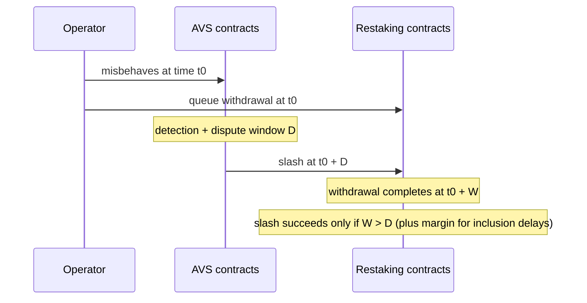

# Slashing Design and Its Failure Modes

Slashing makes misbehaviour costly. Badly designed slashing either fails to deter attacks or punishes honest operators.

## Properties of good slashing conditions

1. **Objective:** verifiable on-chain from evidence (double signatures, invalid attestations with proofs).
2. **Attributable:** identifies exactly which operator misbehaved.
3. **Proportionate:** penalty matches harm and does not exceed what is needed to deter.
4. **Bug-resistant:** honest operators running correct software are not slashed by software bugs.
5. **Bounded:** maximum slashable amount per AVS is known to restakers.

The canonical objective condition is equivocation: two signatures by the same key over conflicting messages for the same slot or task. Anyone can submit both signatures to a contract, which verifies them and slashes. Conditions like "returned a wrong price" are much harder, because the contract must know the right price, which is the very thing the AVS exists to provide.

## Failure modes

| Failure | Example |
|---|---|
| Subjective slashing | committee vote decides; can be captured or abused |
| Software bug slashing | AVS client bug causes honest operators to equivocate |
| Correlated slashing | many operators run the same buggy client and are slashed together |
| Unslashable stake | withdrawal delay shorter than slashing window; operators exit before penalty |
| Slashing griefing | attacker triggers conditions against others (e.g. by manipulating inputs) |

## Timing: the slashing window

For slashing to bite, stake must still be in place when the slashing transaction lands. The timeline has three parts: the fault happens, it is **detected and proven** (dispute or challenge period), and the slash executes. If an operator can request withdrawal right after the fault and complete it before the slash executes, the stake is unslashable.



Add a margin for censorship and congestion: a slashing transaction that can be delayed by a few hours needs those hours of extra withdrawal delay.

## Correlated slashing and Ethereum's precedent

Ethereum's consensus layer includes a **correlation penalty**: validators slashed around the same time as many others lose more. The idea is that isolated mistakes are probably accidents, while mass slashing is probably an attack. AVSs that copy only the base penalty miss this nuance. Conversely, if an AVS client bug makes 40% of operators equivocate, a correlation penalty punishes honest operators heavily for someone else's bug.

## Veto committees

Some designs add a veto committee to reverse wrongful slashing. This reduces bug risk but reintroduces trust. Review who sits on it and how it is governed.

## Worked example

> **Execution status:** The Solidity vault and Foundry test were not executed in this book's CI; verify locally with `forge test`. The correlated-slashing figure is hand-computed.

Build a toy slashable vault in Foundry and show that stake escapes when the withdrawal delay is shorter than the dispute window. Run it on a local Anvil chain or in `forge test` only.

```solidity
// SPDX-License-Identifier: MIT
pragma solidity ^0.8.24;

contract ToyVault {
    mapping(address => uint256) public stake;
    mapping(address => uint256) public unlockAt;
    uint256 public immutable withdrawDelay;
    address public immutable slasher;
    constructor(uint256 d, address s) { withdrawDelay = d; slasher = s; }

    function deposit() external payable { stake[msg.sender] += msg.value; }
    function queueWithdraw() external { unlockAt[msg.sender] = block.timestamp + withdrawDelay; }
    function withdraw() external {
        require(unlockAt[msg.sender] != 0 && block.timestamp >= unlockAt[msg.sender], "locked");
        uint256 a = stake[msg.sender]; stake[msg.sender] = 0;
        payable(msg.sender).transfer(a);
    }
    function slash(address op, uint256 amt) external {
        require(msg.sender == slasher, "auth");
        stake[op] -= amt > stake[op] ? stake[op] : amt;
    }
}
```

```solidity
function test_escapeWhenDelayTooShort() public {
    ToyVault v = new ToyVault(2 days, slasher);    // dispute window is 7 days
    vm.deal(op, 32 ether);
    vm.startPrank(op); v.deposit{value: 32 ether}(); v.queueWithdraw(); vm.stopPrank();
    vm.warp(block.timestamp + 2 days);
    vm.prank(op); v.withdraw();                    // operator leaves
    vm.warp(block.timestamp + 5 days);
    vm.prank(slasher); v.slash(op, 16 ether);      // nothing left to slash
    assertEq(v.stake(op), 0);
    assertEq(op.balance, 32 ether);
}
```

Run `forge test -vv`. Expected: the test passes, demonstrating escape. Change the delay to `8 days` and write the mirror test asserting that `withdraw()` reverts with `locked` before the slash and that the slash reduces stake. A real system would also freeze withdrawal while a slashing proposal is pending; add that as a third test.

**Correlated slashing estimate.** With 100 operators each holding 32 ETH, a client bug affecting 40% of them under a flat 50% penalty slashes 40 × 16 = 640 ETH from honest operators. Under a correlation penalty that scales with the fraction slashed, the loss is higher still. Write both numbers in your review; they are the cost of client monoculture.

## Common pitfalls

- **Slashing conditions that require an oracle for "truth".** The AVS then trusts whoever provides that truth.
- **Withdrawal delays set by convenience.** They must exceed detection plus dispute plus inclusion margins.
- **No slashing protection in operator tooling.** Restarts and failovers cause accidental double-signing.
- **Unbounded penalties.** Restakers cannot price risk they cannot bound.
- **Veto committees with no transparency.** Who they are and how fast they act must be public.

## Exercises

1. Write slashing conditions for a simple oracle AVS and evaluate them against the five properties.
2. Compute the minimum withdrawal delay needed to make slashing enforceable for a given dispute window.
3. Model correlated slashing if 40% of operators run one client with a bug.
4. Extend the Foundry vault with a "pending slash freezes withdrawals" rule and test it.

## Further reading

- EigenLayer slashing docs: <https://docs.eigenlayer.xyz>
- Ethereum consensus slashing conditions: <https://ethereum.org/en/developers/docs/consensus-mechanisms/pos/rewards-and-penalties/>
- Foundry book: <https://book.getfoundry.sh>
- Ethereum consensus specs (slashing and correlation penalty): <https://github.com/ethereum/consensus-specs>
