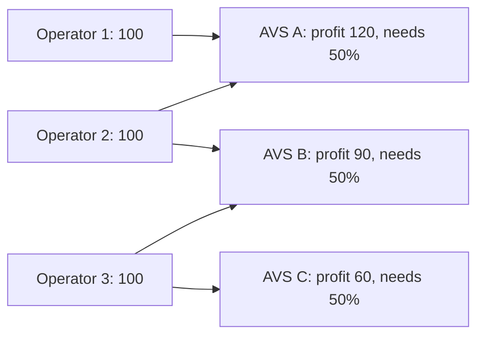

# Crypto-Economic Attack Models

## Cost of corruption vs profit from corruption

A system is economically secure if, for any attacker coalition:

```
cost_of_corruption (stake slashed + other costs) > profit_from_corruption (value extractable)
```

With restaking, the **same stake** secures several AVSs. An attacker controlling enough stake might attack several AVSs simultaneously, where the sum of profits exceeds the stake slashed once.

Both sides of the inequality are harder to estimate than they look:

| Term | What to include | Common mistake |
|---|---|---|
| Stake slashed | only stake that is allocated, slashable and cannot exit first | using total delegated stake |
| Other costs | reputation, legal exposure, cost of acquiring stake | assuming zero (anonymous operators) or infinite (named firms) |
| Profit | value movable during the attack window across all AVSs attacked together | per-AVS TVL in isolation |
| Attack window | time until detection and response | assuming instant response |

## The "stake overloading" problem

Research on restaking (e.g. Durvasula & Roughgarden, "Robust Restaking Networks", 2024) models when a restaking network is secure against such simultaneous attacks and how local shocks spread. Key ideas:
- security depends on the **graph** of which stake secures which services;
- an attack on one service can reduce stake available to secure others (cascades);
- overcollateralisation buffers protect against cascades.

The graph view is the key change from single-chain thinking. In a single proof-of-stake chain, "an attacker needs one third (or two thirds) of stake" is enough analysis. In a restaking network, a coalition of operators chooses *which subset of services* to attack, and profits add up across that subset while stake is lost only once.



## Practical analysis for an AVS

1. Estimate maximum profit from corrupting the AVS (e.g. value of assets it secures in one attack window).
2. Determine stake actually delegated to its operators.
3. Identify other AVSs sharing the same operators/stake.
4. Ask: could one coalition attack several of them at once profitably?

## Worked example

> **Execution status:** Steps 1–3 were executed with Python 3 while writing this chapter; the outputs quoted below were observed. Step 4 was not executed.

Brute-force the coalition check for the small network in the diagram, then add a shock and watch it cascade. This is a model to build intuition, not a security proof.

**Step 1: the model.**

```python
from itertools import combinations

stake = {"O1": 100, "O2": 100, "O3": 100}
avs = {  # name: (operators securing it, profit if corrupted, fraction of its stake needed)
    "A": ({"O1", "O2"}, 120, 0.5),
    "B": ({"O2", "O3"}, 90, 0.5),
    "C": ({"O3"}, 60, 0.5),
}

def corruptible(coalition, s):
    out = []
    for name, (ops, profit, need) in avs.items():
        total = sum(s[o] for o in ops)
        have = sum(s[o] for o in ops & coalition)
        if total and have / total >= need:
            out.append(name)
    return out

def attacks(s):
    ops = list(s)
    for k in range(1, len(ops) + 1):
        for c in combinations(ops, k):
            c = set(c)
            targets = corruptible(c, s)
            profit = sum(avs[t][1] for t in targets)
            cost = sum(s[o] for o in c)
            if profit > cost:
                yield sorted(c), targets, profit, cost

for row in attacks(stake):
    print(row)
```

**Step 2: read the output.** Six coalitions profit. The first line, `(['O1'], ['A'], 120, 100)`, is a plain single-service failure: with a 50% threshold, one operator controls A, and A's profit exceeds that operator's stake. The more instructive lines are `(['O2'], ['A', 'B'], 210, 100)` and `(['O3'], ['B', 'C'], 150, 100)`. B on its own looks safe: its profit (90) is below any single operator's stake (100). But Operator 2 holds half the stake of both A and B, so attacking both earns 210 against 100 slashed. Shared operators make profits additive.

**Step 3: a shock.** Suppose an unrelated AVS slashes Operator 3 by 60% for a client bug. Set `stake["O3"] = 40` and re-run. AVS C's security falls to 40 against a profit of 60, so Operator 3 alone now profits from attacking C, and the coalition of Operators 2 and 3 can take all three services for 140 of stake instead of 200. That is a cascade: a loss in one place weakens services elsewhere.

**Step 4: defend.** Try two fixes and re-run each: require 67% instead of 50% for B, or add a fourth operator to B and C. Record which attacks disappear. Overcollateralisation, meaning stake comfortably above the profit, is what the robust-restaking literature recommends as a buffer.

## Common pitfalls

- **Analysing each AVS alone.** Shared operators make profits additive.
- **Using nominal TVL as profit.** Profit is what an attacker can actually extract in the attack window, which may be more (leverage, bribery) or less (rate limits).
- **Assuming operators are independent.** Several operators may be one entity, or share a cloud account.
- **Ignoring the cost of acquiring stake.** Attackers can borrow, bribe or rent; cost may be far below stake value.
- **Forgetting dynamics.** Stake moves; a network secure today may not be tomorrow. Re-run the model on current data.

## Exercises

1. Build a small graph model (operators, stake, AVSs) and compute whether any coalition profits from attacking a subset of AVSs.
2. Add a shock (one AVS slashes 20% of an operator) and compute cascade effects.
3. Read the Durvasula–Roughgarden paper and summarise its main condition.
4. Extend the model so that an attacker's cost also includes a bribe paid to delegators, and see how it changes results.

## Further reading

- Durvasula & Roughgarden, "Robust Restaking Networks" (2024; search arXiv for the title)
- EigenLayer whitepaper sections on cryptoeconomic security
- Ethereum consensus specs, for the slashing and correlation penalty baseline: <https://github.com/ethereum/consensus-specs>
