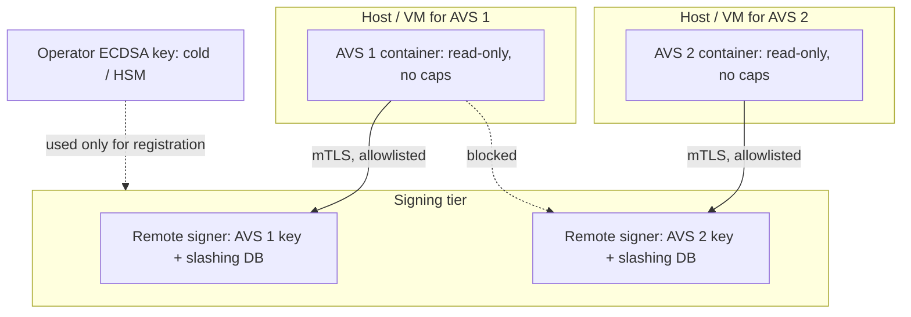

# Operator Security

Operators run software for many AVSs on behalf of restakers. Each AVS adds code, keys and attack surface to the operator's infrastructure.

## Risks

- **Key sprawl:** separate signing keys per AVS; some may live on the same hosts.
- **Untrusted AVS software:** an operator runs container images supplied by each AVS team. A malicious or compromised AVS image could attack the operator's other workloads or keys.
- **Correlated failures:** shared infrastructure means one outage hits several AVSs.
- **Slashing protection:** like Ethereum validators, operators need anti-double-signing databases per AVS.

The second risk is the one most specific to restaking. An Ethereum validator runs software from a handful of well-reviewed client teams. A restaking operator may run images from a dozen young AVS teams, each with its own release process, dependencies and CI. Any of them is a supply-chain entry point into the operator's infrastructure, and from there to keys that control stake for every AVS the operator serves.

## Controls

| Control | Purpose |
|---|---|
| Isolate each AVS (separate VMs/nodes, network policies) | contain malicious or buggy software |
| Remote signers / HSMs with per-AVS keys | protect keys; enforce slashing protection |
| Pin and verify AVS images | prevent supply chain compromise |
| Monitor per-AVS behaviour | detect anomalies before slashing |
| Due diligence before opting in | read slashing conditions; assess code quality |



Keep the operator's main identity key, the one that registers with the restaking protocol and controls delegation settings, away from AVS hosts entirely. AVS-specific signing keys belong on remote signers that only the matching AVS host can reach.

## Slashing protection in practice

A slashing-protection database records what a key has signed (for example, the highest slot or task ID) and refuses to sign anything conflicting. It must live with the signer, not with the AVS client, so that a restarted or duplicated client cannot bypass it. The most common cause of accidental slashing on Ethereum has been running the same key in two places during migrations or failovers. Restaking multiplies the number of keys and therefore the number of migrations.

## Worked example

> **Execution status:** Not executed in this book's CI; verify locally. Outputs described as "expected" are what the tools should show, not observed results.

Harden one AVS container on a local host and verify its image before running it. Use a test image you control or an AVS's published testnet image.

**Step 1: pin by digest and verify the signature.** If the AVS team signs images with Sigstore cosign, verify against their expected identity:

```bash
IMG=registry.example/avs-node@sha256:<digest>
cosign verify "$IMG" \
  --certificate-identity-regexp 'https://github.com/<avs-org>/.+' \
  --certificate-oidc-issuer https://token.actions.githubusercontent.com
```

Expected: a verification summary listing the signing certificate. If the team does not sign images, record that as a due-diligence finding.

**Step 2: run with least privilege on its own network.**

```bash
docker network create --internal avs1-net        # no external route
docker run -d --name avs1 --network avs1-net \
  --read-only --tmpfs /tmp \
  --cap-drop ALL --security-opt no-new-privileges \
  --pids-limit 256 --memory 2g --cpus 2 \
  -v avs1-data:/data \
  "$IMG"
```

Connect the container to a second network only for the endpoints it truly needs (its RPC provider, its remote signer).

**Step 3: prove isolation.** From inside the AVS 1 container, try to reach AVS 2's signer and the host's Docker socket:

```bash
docker exec avs1 sh -c 'nc -zv -w 2 avs2-signer 9000; ls -l /var/run/docker.sock'
```

Expected: connection refused or name resolution failure, and no Docker socket. If either succeeds, the isolation is not real. Many images lack `nc`; use a sidecar debug container on the same network if needed.

**Step 4: opt-in checklist entry.** Record: image signed? digest pinned? required privileges? required inbound ports? slashing conditions read? key type and where it lives? This becomes the per-AVS page in your runbook.

## Common pitfalls

- **Mounting the Docker socket "for monitoring".** It grants root on the host to the container.
- **One host for all AVSs.** A single compromised image reaches every key on it.
- **Tag-based image updates.** `latest` turns the AVS team's registry into a remote-control channel.
- **Keys in environment variables.** They leak into logs, crash dumps and `docker inspect`.
- **Duplicated keys during failover.** Two active instances with the same key is how honest operators get slashed.
- **Opting in for points without reading slashing conditions.** The operator, not the AVS, absorbs the reputational damage.

## Exercises

1. Design an operator deployment for three AVSs with isolation and remote signing.
2. Review one AVS's operator documentation for required privileges.
3. Write a checklist for opting in to a new AVS.
4. Run the worked example's isolation test and document every path you had to close.

## Further reading

- Web3Signer (remote signer with slashing protection): <https://docs.web3signer.consensys.io>
- EigenLayer operator docs: <https://docs.eigenlayer.xyz>
- Sigstore cosign: <https://docs.sigstore.dev>
- Docker security documentation: <https://docs.docker.com/engine/security/>
- EIP-3076 (slashing protection interchange format): <https://eips.ethereum.org/EIPS/eip-3076>
- See **web3-supply-chain-security** for image pinning.
