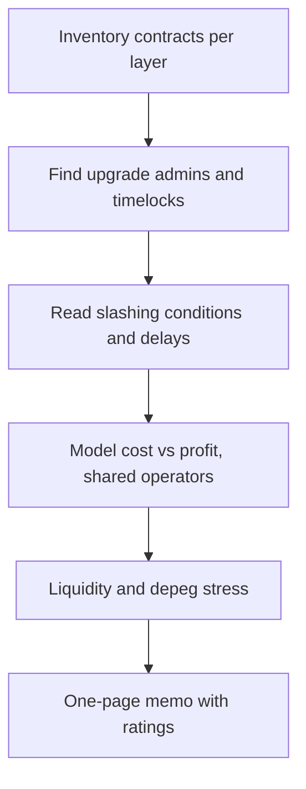

# A Restaking Risk Review Template

This template turns the earlier chapters into a review you can run in a few days. It is written for four audiences, each with a different question: an AVS ("is our borrowed security real?"), an LRT protocol ("what can our holders lose?"), a DeFi integrator ("can we liquidate this collateral safely?") and a restaker ("what am I exposed to?").

## For an AVS

- [ ] Slashing conditions objective, attributable, proportionate (Chapter 2).
- [ ] Cost of corruption vs profit from corruption estimated, including shared stake.
- [ ] Operator set diversity (clients, infrastructure, jurisdictions).
- [ ] Upgrade keys and veto committees documented.
- [ ] Liveness plan if operators leave.

## For an LRT protocol

- [ ] Operator and AVS selection policy published.
- [ ] Maximum slashing exposure per AVS bounded.
- [ ] Withdrawal mechanics and delays clear; stress scenarios modelled.
- [ ] Oracle and exchange-rate update logic audited.

## For DeFi integrators

- [ ] LRT collateral parameters consider depeg and withdrawal delay.
- [ ] Liquidation liquidity sufficient at stressed prices.
- [ ] Oracle uses robust pricing.

## For restakers

- [ ] Understand which AVSs your stake secures and their slashing risk.
- [ ] Understand upgrade keys at every layer.

## Scoring

Checklists hide severity. Pair each item with a rating and evidence:

| Rating | Meaning |
|---|---|
| Green | verified on-chain or in code, with a reference |
| Amber | documented but not verified, or verified with caveats |
| Red | missing, contradicted by code, or controlled by a single key |
| Unknown | could not be determined; treat as red for decisions |

"Unknown" deserves its own row because restaking stacks are deep, and reviewers often run out of time on the lower layers. Saying so is more useful than guessing.



## Worked example

> **Execution status:** Not executed in this book's CI; verify locally. Outputs described as "expected" are what the tools should show, not observed results. The EIP-1967 slot values are from the EIP.

Discover who can upgrade a proxy contract, which is the first question for every layer. Do this against a local fork, so you only read state; never send transactions to mainnet as part of a review.

**Step 1: start a local fork.**

```bash
anvil --fork-url "$MAINNET_RPC_URL" --port 8545
```

**Step 2: read the EIP-1967 slots.** Most upgradeable contracts store the implementation and admin at standard storage slots defined by EIP-1967:

```bash
P=<proxy address from the protocol's docs>
IMPL_SLOT=0x360894a13ba1a3210667c828492db98dca3e2076cc3735a920a3ca505d382bbc
ADMIN_SLOT=0xb53127684a568b3173ae13b9f8a6016e243e63b6e8ee1178d6a717850b5d6103
cast storage $P $IMPL_SLOT --rpc-url http://127.0.0.1:8545
cast storage $P $ADMIN_SLOT --rpc-url http://127.0.0.1:8545
```

Each returns a 32-byte word; the last 20 bytes are an address. Take the admin address and ask what it is:

```bash
A=<admin address>
cast code $A --rpc-url http://127.0.0.1:8545 | head -c 80     # empty = EOA
cast call $A "owner()(address)" --rpc-url http://127.0.0.1:8545
cast call $A "getMinDelay()(uint256)" --rpc-url http://127.0.0.1:8545   # if a timelock
cast call $A "getThreshold()(uint256)" --rpc-url http://127.0.0.1:8545  # if a Safe
```

Not every call will succeed; the ones that do tell you whether the admin is a ProxyAdmin, an OpenZeppelin timelock, a Safe multisig, or a single externally owned account. Follow the chain until you reach people: "a 3-of-5 Safe behind a 10-day timelock" is a very different finding from "one EOA".

**Step 3: record it.**

| Layer | Contract | Admin chain | Delay | Rating |
|---|---|---|---|---|
| LRT | deposit pool proxy | ProxyAdmin → Safe (k-of-n) | timelock d days | fill in |
| Restaking | strategy manager | fill in | fill in | fill in |
| Integrator | LRT oracle adapter | fill in | fill in | fill in |

**Step 4: write the memo.** One page: the three highest-risk findings with evidence, the "unknown" rows, and a recommendation (for example, collateral cap, opt-in conditions or "do not integrate yet"). Send any vulnerability, as opposed to design risk, privately to the project first.

## Common pitfalls

- **Reviewing docs instead of contracts.** Admin addresses in documentation go stale; storage slots do not lie.
- **Stopping at the first multisig.** Who the signers are, and whether they are independent, matters.
- **Ignoring non-proxy admin powers.** Pausers, parameter setters and oracle updaters can matter more than upgraders.
- **Using a stale snapshot.** Restaking parameters change through governance; date every finding.
- **No liquidity analysis for integrators.** Collateral that cannot be sold is not collateral.

## Exercises

1. Apply the AVS section to one live AVS.
2. Apply the integrator section to one lending market listing an LRT.
3. Present the findings as a one-page risk memo.
4. Trace the admin chain for every proxy in one LRT's deployment and compute the shortest delay between a malicious proposal and execution.

## Further reading

- EigenLayer docs: <https://docs.eigenlayer.xyz>
- Symbiotic docs: <https://docs.symbiotic.fi>
- Durvasula & Roughgarden, "Robust Restaking Networks" (2024)
- EIP-1967 (proxy storage slots): <https://eips.ethereum.org/EIPS/eip-1967>
- Foundry `cast` reference: <https://book.getfoundry.sh/reference/cast/>
